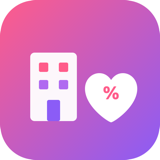
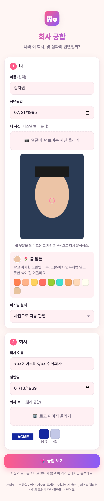
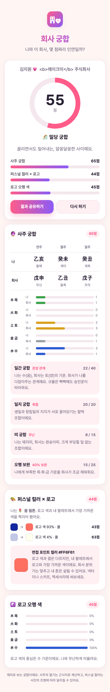
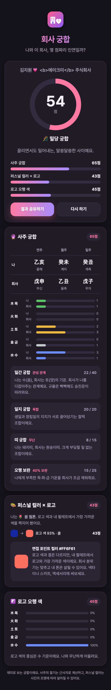

<!-- LEARNING-START -->
## 처음 읽는 분을 위한 안내

**학습 위치:** [앱을 만들고 운영하는 사례](#engineering) · 1/7

생년월일·사진·로고를 넣으면 어떤 계산을 거쳐 점수가 나오는지 따라가는 개발기다. AI 모델을 학습하는 이야기는 아니다. 입력 선택, 계산 규칙, 화면 검증을 나눠 읽으면 웹앱이 만들어지는 흐름을 이해할 수 있다.

**먼저 알아둘 말**

- [브라우저·서버](#web): 브라우저는 사용자가 웹페이지를 여는 프로그램이고, 서버는 요청을 받아 파일이나 데이터를 제공하는 쪽이다.
- [배포·운영](#deployment): 배포는 만든 프로그램을 사용자가 접근할 수 있는 환경에 올리는 일이다. 운영은 그 뒤 계속 사용할 수 있도록 관리하는 일이다.

**이번 글의 목표:** 입력 정보가 점수와 화면 결과로 바뀌는 흐름 이해하기.

**이 학습 경로의 앞 글:** [AI 기초 설명]().

**본문에서 먼저 볼 순서:** **들어가며** → **1. 시작은 빈 폴더 하나** → **2. 점수는 세 가지를 섞는다**.

첫 독서에서는 사용자가 하는 일과 각 장치가 맡는 일을 따라가자. 설치 명령과 설정 이름은 실제로 구현할 때 다시 확인해도 된다.

<!-- PAPER-PREREQUISITES -->
### 선수 개념과 읽을 논문

**먼저 이해할 개념:** 입력과 출력, 브라우저와 서버, 파일과 DB, 사용자 계정과 접근 권한.

이 글의 출발점은 [AI 기초 설명]()과 위의 실습·시스템 개념이다. 학습 경로의 앞 글에서 입력·처리·출력의 흐름을 확인한 뒤 읽으면 된다.

<!-- PAPER-PREREQUISITES-END -->

<!-- LEARNING-START-END -->

---

> **🔗 직접 해보기: <https://check-your-profile-7wz6.vercel.app>**
> 생년월일과 회사 설립일만 넣으면 바로 궁합 점수가 나온다. 사진과 생년월일은 서버로 보내지 않는다.

## 들어가며

> "나랑 이 회사, 궁합이 몇 점일까?"

이 질문 하나로 시작해서, 빈 폴더 하나가 실제로 배포된 서비스가 되기까지를 4편에 나눠 정리한다. AI 코딩 도구인 **Claude Code**와 대화하며 만들었다. 내가 "이런 걸 만들고 싶다"고 말하면 Claude가 선택지를 정리하고, 내가 방향을 고르면 코드를 짜고 테스트까지 돌리는 방식이었다. 개발을 잘 모르는 사람도 읽을 수 있게 어려운 용어는 풀어서 썼다.

| 편 | 다루는 내용 |
|---|---|
| **1편 (이 글)** | 사주 계산, 사진으로 퍼스널 컬러 판별, 로고 색 뽑기, 점수 다듬기 |
| [2편: 내 맥북에서 서비스해 보기]() | M1 맥북 에어로 서버 운영, 부하 테스트, 그리고 방향 전환 |
| [3편: Supabase와 Vercel로 진짜 서비스 만들기]() | 회원·기록·공유 링크·랭킹, 보안 설계, 실제 배포 |
| [4편: 메일 없이 로그인하기]() | 임시 계정으로 자동 저장, 이메일+비밀번호 가입, 기록 옮기기 |

---

## 1. 시작은 빈 폴더 하나

처음 한 말은 "새 폴더 만들고 이름은 `check_fit_company`로 해줘"였다. 그다음이 "이 폴더에 회사와 내가 궁합이 몇 점인지 체크하는 프로그램을 만들고 싶어"였다.

'궁합'은 뜻이 넓은 말이라 Claude는 바로 코드를 짜지 않고 두 가지를 먼저 물었다.

1. **점수를 어떤 기준으로 매길까?** 연봉·근무 조건 같은 현실적인 적합도, 채용공고와 이력서를 AI로 비교하기, 사주처럼 재미로 보는 궁합 중에서 고르라는 질문이었다.
2. **어떤 형태로 만들까?** 웹페이지, 터미널 프로그램, 파이썬 웹앱 중에서 고르라는 질문이었다.

내 대답은 이랬다.

- 기준: **사주처럼 재미로 보는 궁합**. 여기에 사진을 넣으면 **퍼스널 컬러**를 판별하고 **회사 로고 색**과의 궁합도 보는 식으로.
- 형태: **나중에 앱으로 배포하고 싶다**.

앱으로 배포할 생각이라면 처음부터 **웹앱(PWA)** 으로 만드는 게 유리하다. PWA는 휴대폰 홈 화면에 앱처럼 설치할 수 있는 웹사이트다. 나중에 Capacitor 같은 도구로 감싸면 앱스토어용 앱으로도 바꿀 수 있다.

## 2. 점수는 세 가지를 섞는다

| 항목 | 필요한 입력 | 비중 |
|---|---|---|
| 사주 궁합 | 내 생년월일 + 회사 설립일 | 50% |
| 퍼스널 컬러 × 로고 | 내 사진(또는 직접 고른 시즌) + 회사 로고 | 30% |
| 로고 오행 색 | 회사 로고 + 내 생년월일 | 20% |

사진이나 로고가 없으면 해당 항목을 빼고 입력한 항목끼리 비중을 다시 나눠 100점 만점으로 계산한다. 그래서 생년월일과 설립일만 넣어도 결과를 볼 수 있다.

여기서 비중은 입력 항목이 모두 있을 때의 기준이다. 사진이 없는데 컬러 항목에서 점수를 깎으면, 사진을 올리지 않았다는 이유만으로 총점이 낮아진다. 그래서 빠진 항목은 계산에서 제외하고 실제로 입력한 항목 안에서 비중을 다시 나눴다. 결과를 볼 때도 어떤 재료로 점수를 계산했는지 함께 보여주는 편이 이해하기 쉽다.

## 3. 사주를 컴퓨터로 계산하기

### 3.1 사주가 뭔지 아주 짧게

사주(四柱)는 '네 개의 기둥'이라는 뜻으로, 태어난 **연·월·일·시**를 각각 두 글자로 나타낸 것이다. 두 글자는 이렇게 이루어진다.

- **천간** 10개: 甲乙丙丁戊己庚辛壬癸 (갑을병정무기경신임계)
- **지지** 12개: 子丑寅卯辰巳午未申酉戌亥 (자축인묘진사오미신유술해, 띠의 12동물과 같다)

천간과 지지를 하나씩 짝지으면 60가지 조합이 나오는데, 이것이 **60갑자**다. '갑자년', '계묘년' 할 때의 그 갑자다.

### 3.2 회사에는 태어난 시각이 없다

회사 설립일에는 날짜만 있고 시각이 없다. 그래서 **시주는 빼고 연주·월주·일주 세 기둥만** 계산했다. 공평하게 사람도 똑같이 세 기둥만 쓴다. 덕분에 사용자는 태어난 시각을 몰라도 된다.

### 3.3 세 기둥을 구하는 방법

- **연주**: 사주에서 새해는 1월 1일이 아니라 **입춘(2월 4일 무렵)** 에 시작한다. 그래서 1월생이나 2월 초에 태어난 사람은 전년도 연주를 쓴다.
- **월주**: 달도 양력 1일이 아니라 **절기**(소한, 입춘, 경칩…)를 기준으로 바뀐다. 절기 날짜는 해마다 하루쯤 달라지지만 재미용이라 매년 같은 날짜로 근사했다.
- **일주**: 날짜마다 60갑자가 하루씩 순서대로 돌아간다. 천문학에서 쓰는 **율리우스 일수**(기원전 4713년부터 센 날짜 번호)로 바꾼 다음 60으로 나눈 나머지를 쓰면 된다.

계산이 맞는지는 이미 알려진 날짜로 확인했다.

| 날짜 | 알려진 값 | 계산 결과 |
|---|---|---|
| 1900년 1월 1일 일주 | 甲戌 (갑술) | ✅ 甲戌 |
| 2000년 1월 1일 일주 | 戊午 (무오) | ✅ 戊午 |
| 2024년 10월 8일 연·월주 | 甲辰년 甲戌월 | ✅ 甲辰 甲戌 |
| 2024년 2월 3일 (입춘 전날) 연주 | 癸卯년 (전년도) | ✅ 癸卯 |

### 3.4 사주 점수는 네 부분 (100점)

| 부분 | 배점 | 보는 것 |
|---|---|---|
| 일간 궁합 | 40점 | 태어난 날의 천간(일간)끼리의 관계. 회사가 나를 키워주는지(인성), 나와 같은 기운인지(비견), 내가 회사를 이끄는지(재성) 등 |
| 일지 궁합 | 20점 | 태어난 날의 지지끼리 끌어당기는지(육합·삼합), 부딪히는지(충) |
| 띠 궁합 | 15점 | 내 띠와 회사 띠의 관계 |
| 오행 보완 | 25점 | 나에게 부족한 오행(목·화·토·금·수)을 회사 사주가 채워주는지 |

결과 문구도 재미있게 썼다. 예를 들어 회사가 나를 다잡는 '관성' 관계면 "규율은 빡빡해도 승진운이 따라와요"가 나온다.

## 4. 사진으로 퍼스널 컬러 판별하기

### 4.1 사진에서 피부색만 골라내기

사진 전체의 평균 색을 쓰면 배경, 머리카락, 옷 색이 섞여 버린다. 그래서 두 단계를 거쳤다.

1. 얼굴이 있을 법한 **사진 가운데 영역**만 본다.
2. 그 안에서 **피부색 범위에 들어가는 픽셀**만 고른다. 색을 밝기(Y)와 색 성분(Cb, Cr)으로 나누는 YCbCr 방식으로 보면 사람 피부색이 일정한 범위에 모이는데, 이 성질을 이용했다.

피부가 잘 안 잡히면 "볼 부분을 톡 누르면 그 자리 피부색으로 다시 분석해요"라고 안내하고, 누른 자리 주변만 다시 분석한다.

### 4.2 웜/쿨, 라이트/딥 나누기

고른 피부색은 **Lab 색공간**으로 바꿨다. Lab은 밝기(L), 빨강-초록(a), 노랑-파랑(b)으로 색을 나타내는 방식이다. 사람 눈이 느끼는 색 차이와 비슷하게 숫자가 움직여서 이런 판별에 잘 맞는다.

- **노란기가 강하면 웜톤, 붉거나 푸른 기가 강하면 쿨톤.** Lab에서 색이 노랑 쪽으로 기운 정도(색상각)로 판단한다.
- **밝으면 라이트, 어두우면 딥.**
- 둘을 조합하면 **봄 웜(밝은 웜), 가을 웜(깊은 웜), 여름 쿨(밝은 쿨), 겨울 쿨(깊은 쿨)** 이 된다.

솔직히 말하면 사진의 조명에 따라 결과가 크게 달라진다. 그래서 화면 아래에 "퍼스널 컬러는 사진의 조명에 따라 달라질 수 있어요"라고 적었고, 이미 자기 퍼스널 컬러를 아는 사람은 직접 고를 수 있게 했다.

## 5. 회사 로고에서 대표색 뽑기

로고 이미지를 올리면 이런 순서로 대표색을 뽑는다.

1. **투명한 부분은 무시한다.**
2. **흰 배경을 뺀다.** 이미지 테두리 대부분이 흰색이면 배경으로 본다. 반대로 빨간 바탕에 흰 글씨처럼 배경 자체가 색이면 그 색이 브랜드 색일 수 있어서 남겨 둔다.
3. **비슷한 색끼리 묶는다.** 글자 테두리의 어중간한 색 같은 잡음은 비율 4% 미만이면 버린다.
4. 비율이 높은 순서로 **최대 4개**를 고른다.

이렇게 뽑은 색으로 두 가지 점수를 낸다.

- **퍼스널 컬러 × 로고**: 로고 색이 내 시즌 팔레트(예: 겨울 쿨은 블랙, 화이트, 네이비, 버건디…)와 얼마나 가까운지, 웜/쿨이 맞는지 본다.
- **로고 오행 색**: 색을 오행으로 바꾼다. 빨강은 화(火), 노랑·갈색은 토(土), 초록은 목(木), 파랑·검정은 수(水), 흰색·회색은 금(金)이다. 로고 색이 나에게 부족한 오행을 채워주면 점수가 오른다.

덤으로 **면접 포인트 컬러**도 알려준다. 내 팔레트에서 로고 대표색과 가장 가까운 색이라, 회사 분위기는 맞추면서 내 피부톤도 살릴 수 있다.

## 6. 사진은 서버로 보내지 않는다

얼굴 사진과 생년월일은 민감한 정보다. 그래서 **모든 계산을 사용자의 브라우저 안에서** 하게 만들었다. 사진은 브라우저 안의 캔버스에 그려 픽셀을 읽을 뿐, 어디에도 전송하지 않는다. 화면에도 이 점을 적어 두었다.

## 7. 만든 다음엔 꼭 직접 돌려본다

계산 로직에는 **자동 테스트 13개**를 붙였다. 날짜별 사주가 맞는지, 흰 배경을 제대로 빼는지, 색을 맞는 오행으로 바꾸는지 같은 것들이다.

여기서 끝내지 않고 실제 브라우저도 자동으로 조작해 봤다. Playwright라는 도구로 휴대폰 크기 화면을 띄워 생년월일을 입력하고 가짜 얼굴 그림과 로고를 올리고 결과 화면을 캡처했다.

*입력 화면. 회사 이름에 일부러 HTML 태그(`<b>`)를 넣어, 태그가 실행되지 않고 글자 그대로 보이는지도 확인했다.*

### 7.1 스크린샷을 보고 찾은 문제 3가지

**① 고친 뒤에도 남아 있는 오류 문구.**
빈칸으로 제출해서 "생년월일을 입력해주세요"가 뜬 뒤 칸을 다 채워도 빨간 문구가 그대로 남아 있었다. 칸을 고치면 바로 지워지게 했다.

**② 점수가 너무 짜다.**
테스트 결과가 46점에 "인연은 따로"였다. 재미로 보는 앱인데 대부분 이렇게 나오면 쓰는 재미가 없다. 그래서 **무작위 입력 2만 건**으로 점수 분포를 시뮬레이션했다.

| 점수 | 보정 전 중앙값 | 보정 후 중앙값 |
|---|---|---|
| 퍼스널 컬러 × 로고 | 41점 | 61점 |
| 최종 점수 | 63점 | 69점 |

컬러 궁합이 너무 박한 게 원인이라 "전혀 안 맞아도 35점은 준다"는 최저점을 넣었다. 지금은 대부분 60~80점대가 나오고, 전체 범위는 45~96점이다. 잘 맞는 조합은 여전히 90점대 "천생연분"이 나온다.

**③ 말이 안 맞는 추천 문구.**
로고는 남색인데 내 팔레트(봄 웜)에서 고른 포인트 컬러는 코랄이었다. 그런데 문구는 "회사 로고와도 어울리는 색"이라고 하고 있었다. 색 거리가 멀면 "로고 색과 결은 다르지만, 내 팔레트에서 로고와 가장 가까운 색이에요"로 바뀌게 했다.

### 7.2 완성된 첫 버전

| 라이트 모드 | 다크 모드 |
|---|---|
|  |  |

*결과 화면. 총점과 등급, 항목별 점수, 사주 원국표, 오행 분포, 컬러 궁합까지 보여준다. 휴대폰이 다크 모드면 자동으로 어두운 화면이 된다.*

## 8. 정리

- '궁합'처럼 뜻이 넓은 요청은 **기준과 형태부터 정하는 게** 먼저였다.
- 사주는 **입춘·절기·율리우스 일수**만 알면 컴퓨터로 계산할 수 있다. 회사에는 시각이 없으니 세 기둥만 쓴다.
- 퍼스널 컬러는 **피부 픽셀 고르기 → Lab 변환 → 웜/쿨·라이트/딥** 순서로 판별한다. 조명의 영향은 솔직하게 알린다.
- **직접 돌려보고 스크린샷을 보는 단계**에서 코드만 봐서는 몰랐을 문제 3개를 찾았다. 특히 점수의 재미는 분포를 시뮬레이션해 봐야 알 수 있었다.

다음 편에서는 이 앱을 **내 M1 맥북 에어에서 직접 서비스**해 보려던 이야기를 한다.

> 다음 편: [회사 궁합 앱 제작기 (2): 내 맥북에서 서비스해 보기 →]()

<!-- LEARNING-END -->
---

## 읽은 뒤 확인하고 다음으로

**확인 질문:** 입력 정보가 점수와 화면 결과로 바뀌는 흐름 이해하기를 목표로, 본문에서 다룬 입력·중간 과정·결과를 자기 말로 설명해 보자. 실험이나 사례가 있다면 어떤 조건에서 확인했는지도 덧붙여 보자.

**다음 글:** [회사 궁합 앱 제작기 (2): 내 맥북에서 서비스해 보기]() — 내 컴퓨터가 하는 일과 방문자의 기기가 하는 일 구분하기.

[전체 학습 순서]() · [용어 사전]()

<!-- LEARNING-END-END -->
