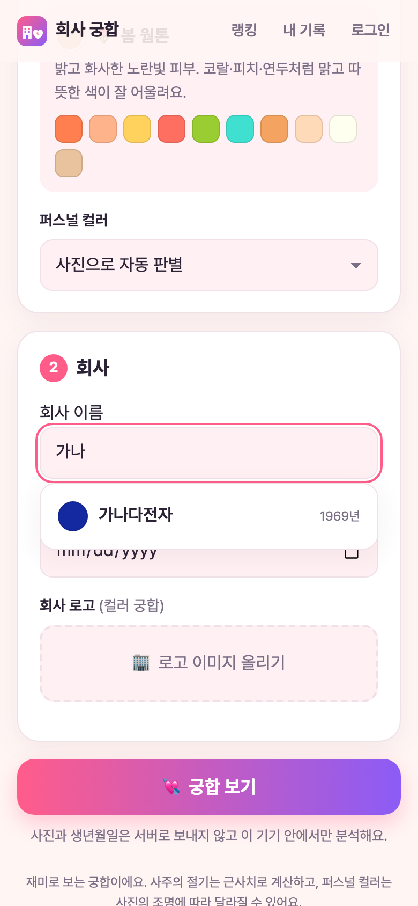
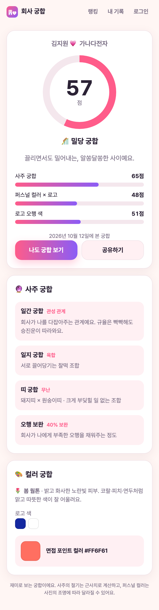
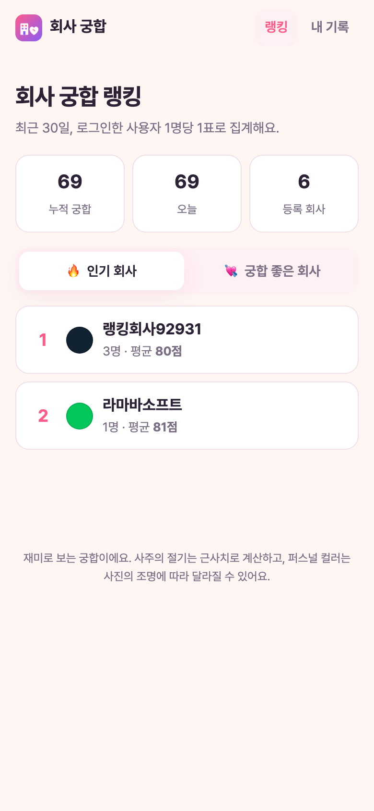
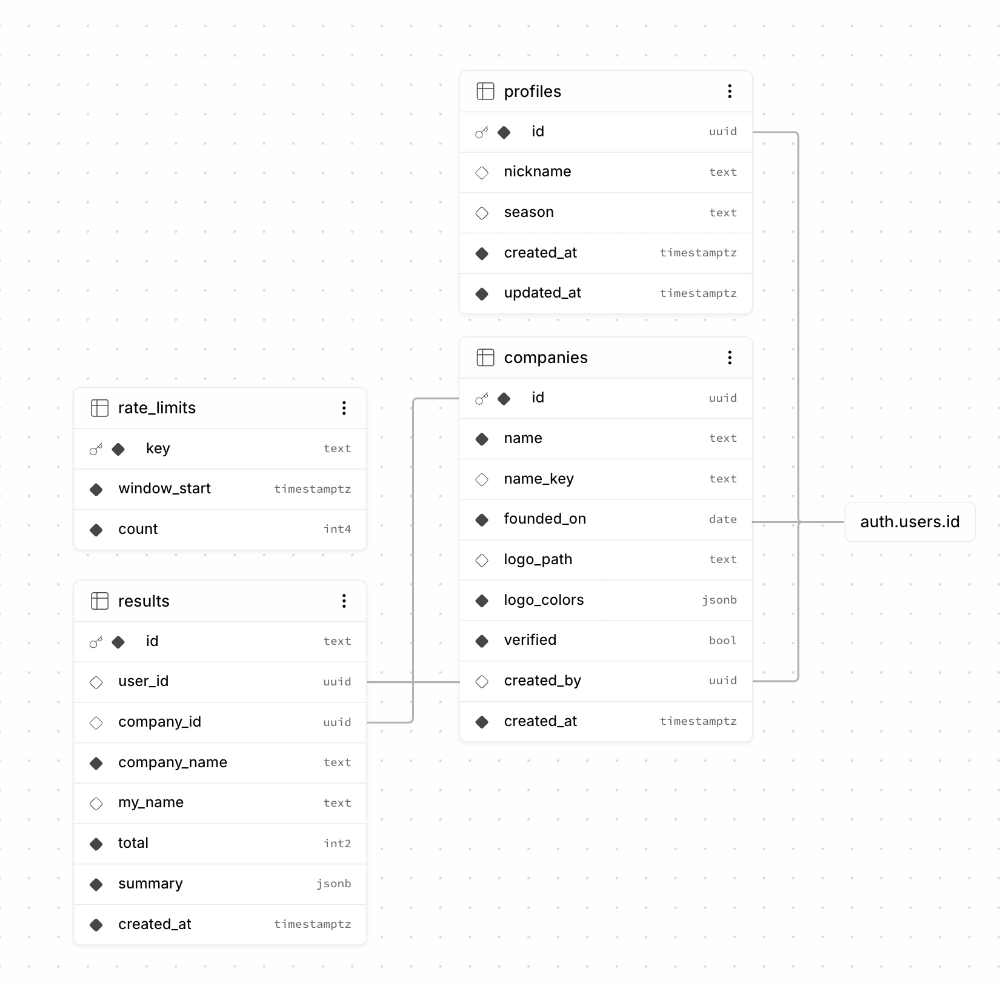

> **🔗 직접 해보기: <https://check-your-profile-7wz6.vercel.app>**
>
> 이전 편: [회사 궁합 앱 제작기 (2): 내 맥북에서 서비스해 보기]()

## 1. 이번 편에서 만든 것

[2편]() 끝에서 정한 대로, 네 가지 기능을 붙이고 실제로 배포했다.

1. **회사 정보 DB**: 회사 이름을 검색하면 설립일과 로고 색이 자동으로 채워진다.
2. **결과 공유 링크**: `/r/abc123xyz9` 같은 링크로 친구에게 공유한다.
3. **회원과 기록**: 내가 본 궁합을 모아본다.
4. **통계와 랭킹**: 누적 궁합 수, 인기 회사, 궁합 좋은 회사를 보여준다.

## 2. 구조: 누가 무엇을 맡나

```
           ┌──────────────── Vercel ────────────────┐
           │  화면 파일 (HTML·CSS·JS·아이콘)            │
           │  보안 헤더, 캐시, 주소 처리                 │
           └────────────────────────────────────────┘
                     ▲ 파일 받기
                     │
   [사용자 브라우저] ── 사주·퍼스널 컬러 계산은 여기서 (사진·생년월일은 밖으로 안 나감)
                     │
                     ▼ 점수 저장, 검색, 랭킹 조회
           ┌─────────────── Supabase ───────────────┐
           │  Postgres DB  ·  로그인  ·  로고 저장소     │
           │  행 단위 보안 규칙(RLS), DB 함수           │
           └────────────────────────────────────────┘
```

- **Vercel**은 화면 파일을 전 세계 곳곳의 서버(CDN)에서 빠르게 내려준다. GitHub에 코드를 올리면 자동으로 다시 배포된다.
- **Supabase**는 DB, 로그인, 파일 저장소를 한 번에 제공한다. 브라우저가 Supabase에 직접 요청하므로 따로 API 서버를 만들 필요가 없다.

### 2.1 빌드 도구 Vite를 들인 이유

지금까지는 빌드 과정 없이 파일을 그대로 썼다. 그런데 Supabase 라이브러리를 쓰려면 여러 파일을 하나로 묶어야 하고, Supabase 주소와 키 같은 **환경 변수**도 넣어야 한다. 그래서 **Vite**를 추가했다. 코드는 여전히 프레임워크 없는 순수 JavaScript다.

Supabase 주소가 설정되지 않은 환경에서는 DB 기능을 숨기고 [1편]()처럼 기기 안에서만 동작하게 해 두었다.

## 3. 무엇을 저장하고, 무엇을 저장하지 않나

DB가 생기면 가장 먼저 정해야 하는 것이 이것이다.

| 저장한다 | 저장하지 않는다 |
|---|---|
| 회사명, 내가 입력한 이름(선택), 총점, 항목별 점수, 사주 관계 이름(예: "육합"), 띠, 퍼스널 컬러 시즌, 로고 대표색 | **생년월일, 사주 원국, 사진** |

사주 원국(연·월·일주 여섯 글자)을 빼는 이유는, 여섯 글자만 있으면 **생년월일을 거의 역추적할 수 있기** 때문이다. 공유 페이지는 점수와 관계 이름만으로도 충분히 재미있게 보여줄 수 있다.

사주 관계는 문구가 아니라 **키**로만 저장한다. 예를 들어 "회사가 나를 키워주는 관계예요" 대신 `supports`라는 값만 넣고, 화면에서 다시 문구로 바꾼다. 누가 DB에 이상한 값을 넣어도 화면에 엉뚱한 문장이 표시되지 않게 하려는 것이다.

## 4. 보안 설계: 쉽게 풀어보기

Supabase에서는 브라우저가 DB에 직접 요청한다. 편리한 대신 **"누가 무엇을 할 수 있는지"를 DB가 직접 지켜야** 한다. 이때 쓰는 기능이 **RLS(Row Level Security, 행 단위 보안)** 다. 표의 줄마다 "이 줄은 누가 볼 수 있다"는 규칙을 다는 기능이라고 생각하면 된다.

### 4.1 규칙 1. 공유 결과는 링크를 아는 사람만

공유 링크를 받은 사람은 그 결과 하나만 볼 수 있어야 하고, **남의 결과 목록을 훑어볼 수는 없어야** 한다.

그래서 결과 표는 비로그인 사용자가 직접 읽지 못하게 막고, `get_shared_result(id)`라는 **DB 함수**를 통해서만 1건씩 조회되게 했다. 링크 id는 10자리 무작위 문자라 사실상 추측할 수 없고, 작성자의 계정 id는 응답에 넣지 않는다.

### 4.2 규칙 2. 랭킹은 1인 1표

점수는 사용자 브라우저에서 계산하므로, 마음먹으면 100점짜리 결과를 조작해 보낼 수도 있다. 그대로 집계하면 랭킹이 쉽게 망가진다.

그래서 랭킹은 **로그인한 사용자 1명당 회사 1표**(가장 최근 결과)로만 집계한다. 조작을 완전히 막을 수는 없지만, 조작해도 한 계정에 한 표뿐이다. 평균 점수 순위인 "궁합 좋은 회사"는 3명 이상이 본 회사만 올라가게 해서, 한 명의 극단적인 점수가 1등이 되지 않게 했다.

### 4.3 규칙 3. 회사는 승인제

누구나 회사를 등록할 수 있으면 장난스러운 이름이 검색과 랭킹에 바로 뜬다. 그래서 로그인 사용자가 등록한 회사는 **'검토 중' 상태**로 들어가고, 관리자가 승인해야 모두에게 보인다. 승인 전에는 등록한 본인에게만 보이고, 사용자가 스스로 '승인됨'으로 바꾸는 것은 막혀 있다.

### 4.4 규칙 4. 로고는 PNG·JPG·WEBP만

로고 업로드는 **본인 폴더에만**, **512KB 이하**의 PNG·JPG·WEBP만 받는다. SVG는 이미지처럼 보이지만 안에 스크립트를 넣을 수 있어서 막았다. 올리기 전에 브라우저에서 캔버스에 다시 그려 PNG로 만들기 때문에, 원본 사진에 있던 위치 정보 같은 메타데이터도 남지 않는다.

### 4.5 규칙 5. 요청 횟수 제한

결과 저장은 사용자당 **시간당 60건**, 회사 등록은 **하루 10건**까지다. 비로그인 사용자는 IP 주소로 구분하는데, 여기서 문제를 하나 발견해 고쳤다.

> **발견한 문제**: IP를 알려주는 `X-Forwarded-For` 헤더는 사용자가 마음대로 써 넣을 수 있다. 또 이 헤더가 없는 환경에서는 모든 비로그인 사용자가 **하나의 한도(시간당 60건)를 나눠 쓰는** 상황이 생긴다.
>
> **해결**: 위조할 수 없는 Cloudflare 헤더(`cf-connecting-ip`)를 먼저 쓰고, IP를 알 수 없으면 제한을 건너뛰게 했다. IP는 원문 대신 **해시값**으로만 저장한다.

## 5. 로컬에서 진짜 Supabase로 검증하기

맥북에 Docker가 있어서 **Supabase 전체를 내 컴퓨터에 띄울 수** 있었다. 실제 서비스와 같은 DB, 로그인, 파일 저장소다. 테스트용 가짜 회사 5곳(가나다전자, 라마바소프트…)도 넣었다.

그리고 "남의 것을 건드릴 수 있는가"를 자동 테스트로 하나하나 확인했다. 비로그인 사용자와 서로 다른 사용자 여러 명을 만들어서 시도했다.

| 테스트 | 결과 |
|---|---|
| 비로그인: 결과 저장·공유 조회는 되고, 결과 목록·내부 함수는 막힘 | ✅ |
| 점수 범위, 요약 크기, 이름 길이 검증 | ✅ |
| 회사는 '검토 중'으로만 등록, 남의 미승인 회사는 안 보임 | ✅ |
| 공백이나 "(주)"만 다른 같은 이름은 중복으로 거부 | ✅ |
| 잘못된 색 값(`red;}body{` 같은 공격 문자열) 거부 | ✅ |
| 내 기록만 보이고, 남의 기록은 못 지움 | ✅ |
| 랭킹: 1인 1표, 비로그인·미승인 회사 제외 | ✅ |
| 로고: 내 폴더에만, PNG만, SVG 금지 | ✅ |
| 시간당 61번째 저장은 차단 | ✅ |

실제 브라우저로도 처음부터 끝까지 돌렸다. 회사 검색 → 궁합 → 공유 링크 복사 → 링크 열기 → 이메일 로그인 → 회사 등록 → 기록 확인 → 랭킹 → 기록 삭제 순서였고, 콘솔 에러 없이 모두 동작했다.

| 회사 검색 | 공유 페이지 | 랭킹 |
|---|---|---|
|  |  |  |

*왼쪽: "가나"만 쳐도 등록된 회사가 나오고, 고르면 설립일과 로고 색이 채워진다. 가운데: 공유 링크로 연 화면. 사주 원국 없이 관계 이름만 보여준다. 오른쪽: 랭킹. 승인된 회사만 보인다.*

## 6. 실제로 배포하기

여기부터는 내가 직접 계정을 만들고 버튼을 누르는 단계였다. Claude는 단계별 안내를 써 주고, 한 단계를 끝낼 때마다 잘 됐는지 확인했다.

### 6.1 Supabase 프로젝트 만들고 DB 구조 올리기

Supabase에서 새 프로젝트를 만들고, 로컬에서 검증한 DB 구조를 그대로 올렸다.

```bash
npx supabase login                         # 브라우저로 로그인
npx supabase link --project-ref <프로젝트ID> # 이 폴더와 내 프로젝트 연결
npx supabase db push --dry-run             # 무엇이 올라갈지 먼저 확인
npm run db:push                            # 실제로 올리기
```

올리고 나니 Supabase 대시보드에서 표 구조가 이렇게 보였다.



*`profiles`(프로필), `companies`(회사), `results`(궁합 결과), `rate_limits`(요청 제한) 4개 표와 연결 관계. 모두 로그인 계정(`auth.users`)과 이어져 있다.*

그림만으로는 보안 규칙까지 들어갔는지 알 수 없어서, 운영 DB에 **읽기만 하는 점검** 9가지를 돌렸다. 운영 DB에 테스트 데이터를 남기지 않기 위해서다. 통계, 검색, 랭킹 함수는 정상 응답했고, 비로그인 사용자의 결과 목록 조회, 내부 함수 호출, 회사 등록은 모두 권한 오류로 막혔다.

### 6.2 GitHub에 올리고 Vercel에 연결하기

1. GitHub에 저장소를 만들고 코드를 올렸다. 로컬용 키가 든 `.env.local` 파일은 `.gitignore`로 빼서 올라가지 않게 했다.
2. Vercel에서 그 저장소를 가져오고 환경 변수 3개를 넣었다.

| 이름 | 값 |
|---|---|
| `VITE_SUPABASE_URL` | Supabase 프로젝트 주소 |
| `VITE_SUPABASE_ANON_KEY` | 공개용 키 (publishable key) |
| `VITE_AUTH_PROVIDERS` | 소셜 로그인 목록 (일단 비워 둠) |

> ⚠️ Supabase에는 공개용 키와 **비밀 키(service_role/secret)** 가 따로 있다. 비밀 키를 브라우저용 환경 변수에 넣으면 모든 보안 규칙이 무시되니 절대 넣으면 안 된다. 공개용 키는 원래 브라우저에 노출되도록 만든 키라서, 앞에서 만든 RLS 규칙이 지켜주는 한 공개되어도 괜찮다.

### 6.3 작은 에피소드: 배포 주소가 어디지?

배포를 마치고 "했어"라고 했더니, Claude가 저장소 이름으로 주소를 추측해 접속해 봤다. 그 주소에서는 `DEPLOYMENT_DISABLED`(배포 비활성화) 오류가 나왔다. 이미 다른 프로젝트가 쓰고 있는 이름이었던 것이다. 같은 이름이 이미 있으면 Vercel은 새 프로젝트 이름 뒤에 무작위 글자를 붙인다.

Vercel 대시보드 주소를 알려주자, 그 안의 프로젝트 이름으로 실제 배포 주소를 찾았다. 그리고 바로 점검했다.

- 운영 Supabase 주소가 빌드에 들어갔고, **로컬 주소는 섞이지 않았는지**
- `/r/...` 같은 주소로 바로 들어가도 화면이 열리는지
- 보안 헤더와 캐시 설정이 적용됐는지
- 실제 브라우저로 열었을 때 콘솔 에러가 없는지

모두 통과했다. 마지막으로 Supabase의 **로그인 후 돌아올 주소**(Site URL, Redirect URLs)에 배포 주소를 등록했다. 이걸 빠뜨리면 로그인 링크를 눌렀을 때 앱으로 돌아오지 못한다.

## 7. 정리

- **Vercel(화면 파일) + Supabase(DB·로그인·저장소)** 조합이면 따로 API 서버 없이 회원제 서비스를 만들 수 있다.
- 그 대신 **보안 규칙을 DB에 직접** 걸어야 한다. 공유는 함수로 1건씩만, 랭킹은 1인 1표, 회사는 승인제로 만들었다.
- 개인정보는 **처음부터 저장하지 않는 것**이 가장 확실한 보호다. 생년월일을 역추적할 수 있는 사주 원국도 저장하지 않았다.
- 운영 DB는 **읽기만 하는 점검**으로 확인하고, 쓰기 테스트는 로컬에서 끝냈다.

그런데 배포하고 써 보니 불편한 점이 하나 있었다. 로그인할 때마다 **메일을 기다려야** 했던 것이다. 다음 편에서 이 문제를 푼다.

> 다음 편: [회사 궁합 앱 제작기 (4): 메일 없이 로그인하기 →]()
