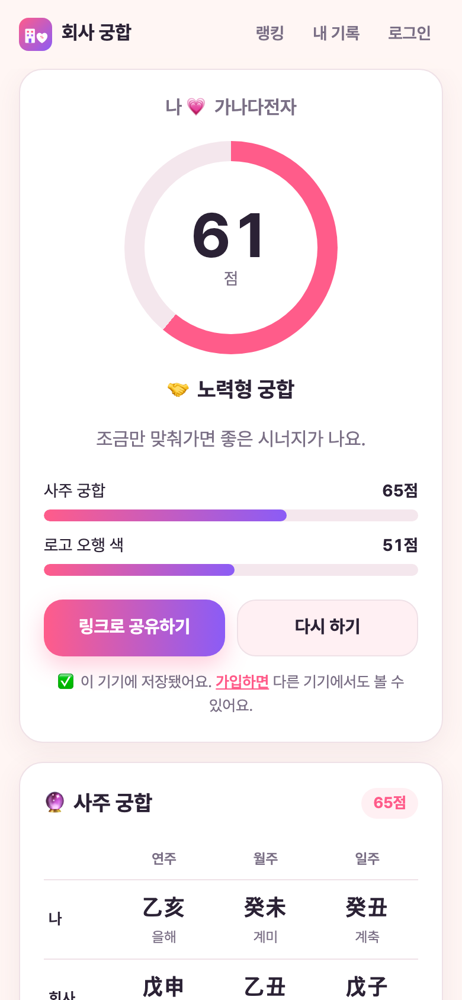
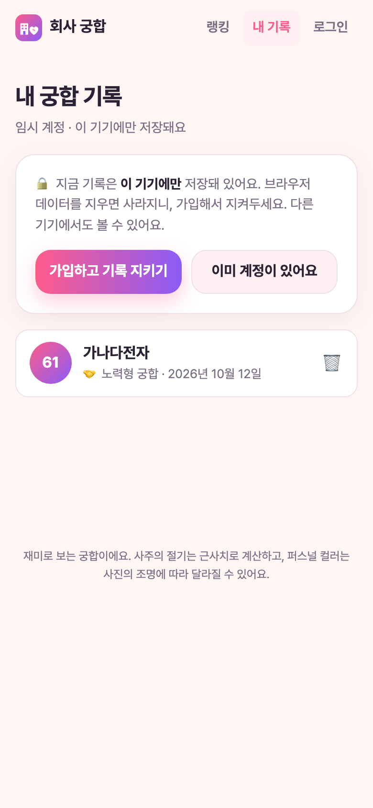
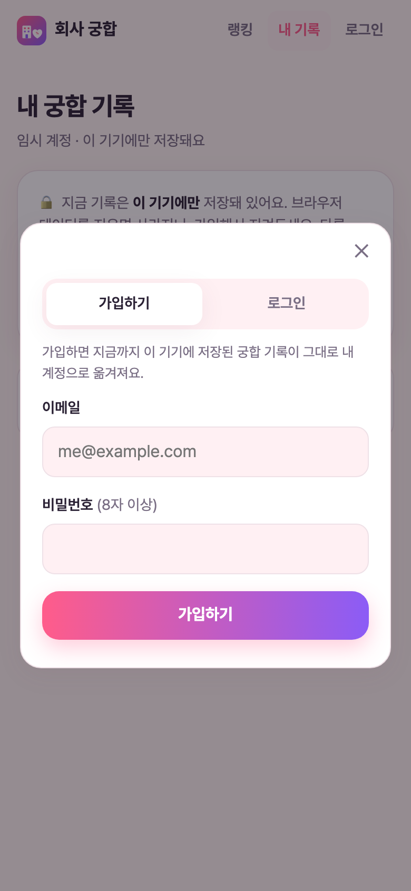
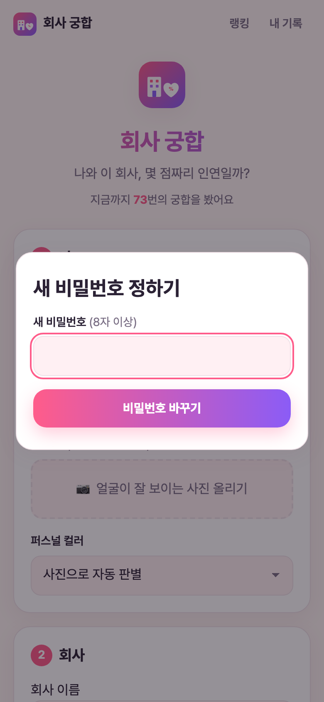

<!-- LEARNING-START -->
## 처음 읽는 분을 위한 안내

**학습 위치:** [앱을 만들고 운영하는 사례](#engineering) · 4/7

처음 방문한 사람이 가입 전에 기록을 저장하고, 나중에 가입해 같은 기록을 계속 쓰게 만드는 과정이다. 기록의 저장 위치와 다시 접근할 수 있는 수단은 다르다. 임시 계정·새 가입·기존 계정 로그인의 세 상황을 나눠 읽으면 된다.

**먼저 알아둘 말**

- [DB·계정·권한](#db): DB는 데이터를 저장하고 조회하는 시스템이다. 계정은 사용자를 구분하고, 권한은 그 사용자가 어떤 데이터를 읽고 바꿀 수 있는지 정한다.
- [브라우저·서버](#web): 브라우저는 사용자가 웹페이지를 여는 프로그램이고, 서버는 요청을 받아 파일이나 데이터를 제공하는 쪽이다.
- [배포·운영](#deployment): 배포는 만든 프로그램을 사용자가 접근할 수 있는 환경에 올리는 일이다. 운영은 그 뒤 계속 사용할 수 있도록 관리하는 일이다.

**이번 글의 목표:** 임시 계정의 저장·가입·기록 이전 구분하기.

**이 학습 경로의 앞 글:** [회사 궁합 앱 제작기 (3): Supabase와 Vercel로 진짜 서비스 만들기]().

**본문에서 먼저 볼 순서:** **1. "메일로 보내는 건 너무 오래 걸리잖아"** → **2. 먼저 짚은 사실: 로그인은 이미 유지되고 있었다** → **3. 임시 계정이란?**.

첫 독서에서는 사용자가 하는 일과 각 장치가 맡는 일을 따라가자. 설치 명령과 설정 이름은 실제로 구현할 때 다시 확인해도 된다.

<!-- PAPER-PREREQUISITES -->
### 선수 개념과 읽을 논문

**먼저 이해할 개념:** 입력과 출력, 브라우저와 서버, 파일과 DB, 사용자 계정과 접근 권한.

이 글의 출발점은 [AI 기초 설명]()과 위의 실습·시스템 개념이다. 학습 경로의 앞 글에서 입력·처리·출력의 흐름을 확인한 뒤 읽으면 된다.

<!-- PAPER-PREREQUISITES-END -->

<!-- LEARNING-START-END -->

---

> **🔗 직접 해보기: <https://check-your-profile-7wz6.vercel.app>**
> 이 글의 기능(임시 계정 자동 저장, 이메일+비밀번호 가입)은 2026년 10월 13일 운영 사이트에 배포했다.
>
> 이전 편: [회사 궁합 앱 제작기 (3): Supabase와 Vercel로 진짜 서비스 만들기]()

## 1. "메일로 보내는 건 너무 오래 걸리잖아"

[3편]()에서 만든 로그인은 **이메일 링크 방식**이었다. 이메일을 입력하면 로그인 링크가 메일로 오고, 그 링크를 누르면 로그인된다. 비밀번호가 필요 없어 간편해 보였지만, 직접 써 보니 문제가 있었다.

- 메일이 오기까지 **몇 분씩** 걸리거나 아예 안 오기도 한다.
- Supabase 기본 메일 서버는 **시간당 몇 통**만 보낼 수 있다.
- 궁합 한 번 보려는 사람에게 "메일함을 확인하세요"는 너무 큰 벽이다.

그래서 이렇게 물었다.

> 링크를 저장된 거로 만들 수 없나? 메일로 보내는 건 너무 오래 걸리잖아.

## 2. 먼저 짚은 사실: 로그인은 이미 유지되고 있었다

Claude가 먼저 짚은 점이 있다. 한 번 로그인하면 그 기기와 브라우저에서는 **로그아웃할 때까지 로그인이 유지**된다. 메일을 받는 건 기기마다 처음 한 번뿐이다. 그래도 그 첫 메일이 느린 건 사실이라, 메일을 기다리지 않는 방법 네 가지를 비교했다.

| 방법 | 장점 | 단점 |
|---|---|---|
| **자동 저장 (임시 계정)** ← 선택 | 로그인 없이 바로 기록 저장 | 가입 전에 브라우저 데이터를 지우면 기록이 사라진다 |
| 카카오·구글 간편 로그인 | 버튼 한 번으로 로그인 | 각 개발자 콘솔에 앱 등록이 필요하다 |
| **이메일 + 비밀번호** ← 선택 | 가입하자마자 로그인 | 비밀번호를 잊으면 재설정은 결국 메일 |
| 메일을 빠르게 (SMTP 연결) | 지금 방식 유지, 메일이 몇 초 만에 온다 | 여전히 메일함을 열어야 한다 |

**자동 저장 + 이메일·비밀번호** 조합을 골랐다.

## 3. 임시 계정이란?

카페 스탬프 카드에 비유하면 쉽다.

- 처음 온 손님에게 **이름 없는 스탬프 카드**를 바로 준다. 가입 절차 없이 스탬프(궁합 기록)를 모을 수 있다.
- 손님이 원하면 그 카드에 **이름과 전화번호를 등록**한다. 카드는 그대로이니 모은 스탬프도 그대로다.
- 이미 등록한 카드가 있는 손님이 새 카드를 받았다면, **새 카드의 스탬프를 원래 카드로 옮겨** 준다.

Supabase에는 이런 **익명 로그인(anonymous sign-in)** 기능이 있다. 앱에서는 이렇게 동작한다.

1. 처음 궁합을 보는 순간 보이지 않는 **임시 계정**이 자동으로 만들어진다.
2. 결과가 바로 **"내 기록"에 저장**된다.
3. 이메일+비밀번호로 **가입하면 같은 계정이 정식 계정**이 된다. 기록이 그대로 남고, 다른 기기에서도 볼 수 있다.

임시 계정은 궁합을 실제로 볼 때만 만든다. 사이트에 들어왔다 나가기만 한 사람까지 계정을 만들면 쓸모없는 계정이 쌓이기 때문이다.

여기서 ‘임시’는 저장 위치가 아니라 로그인 수단을 뜻한다. 기록은 Supabase에 저장되지만, 가입 전에는 현재 브라우저에 남은 로그인 정보로만 그 기록에 접근한다. 브라우저 데이터를 지우면 다시 같은 임시 계정으로 들어갈 방법이 없어지는 것이다. 이메일과 비밀번호를 붙이는 가입 단계는 그 계정에 다시 찾아올 수단을 만드는 과정이다.

## 4. 실험부터: 정말 같은 계정이 이어질까?

설계를 확정하기 전에, 가장 중요한 가정을 로컬 Supabase에서 먼저 실험했다. "임시 계정에 이메일과 비밀번호를 붙이면, 메일 확인 없이 같은 계정이 정식 계정이 되는가?"

```
임시 계정 생성        → id 6b9f…, 임시 계정 = 예
궁합 결과 저장        → 결과 vir9…
이메일+비밀번호 붙이기  → 성공, 임시 계정 = 아니오
같은 id인가?          → 예
다른 기기에서 로그인    → 성공, 기록 [vir9…] 보임
```

"가입 확인 메일" 설정을 끄면 **바로 전환**되고, **같은 id가 유지**되고, 다른 기기에서도 기록이 보였다. 가정이 맞았으니 이 방식으로 진행했다.

## 5. 까다로운 부분: 이미 계정이 있는 사람

헷갈리기 쉬운 상황이 하나 있다.

> 회사 컴퓨터에서 가입해 둔 사람이, 집 노트북에서 궁합을 몇 번 본 뒤(임시 계정으로 저장됨) 원래 계정으로 로그인한다면?

이때는 집에서 만든 임시 계정과 원래 가입한 계정, **두 개**가 따로 있다. 원래 계정으로 로그인해도 임시 계정에 저장한 기록이 자동으로 따라오지는 않는다.

그래서 **일회용 토큰**으로 기록을 옮기게 했다.

1. 로그인 버튼을 누르는 순간, 아직 임시 계정인 상태에서 **"내 기록을 넘길 토큰"** 을 받아 둔다. 10분 동안만 유효하다.
2. 원래 계정으로 로그인한다.
3. 받아 둔 토큰을 내밀면 DB가 임시 계정의 기록을 원래 계정으로 옮긴다.

토큰을 쓰는 이유는 보안이다. 단순히 "저 임시 계정 기록을 나한테 옮겨줘"라고 요청할 수 있으면 남의 기록을 가로챌 수 있다. 토큰은 **그 임시 계정을 실제로 쓰던 브라우저만** 받을 수 있고, **한 번 쓰면 사라진다**.

## 6. 임시 계정이 할 수 없는 것

임시 계정은 누구나 버튼 한 번으로 무한정 만들 수 있다. 그래서 악용될 수 있는 기능에서는 뺐다.

| 기능 | 임시 계정 | 정식 계정 |
|---|---|---|
| 궁합 기록 저장, 공유 링크 | ✅ | ✅ |
| 회사 등록, 로고 업로드 | ❌ | ✅ |
| 랭킹에 반영 | ❌ (계정을 여러 개 만들어 표를 늘릴 수 있으므로) | ✅ |
| 로그아웃 | 버튼 숨김 (로그아웃하면 기록을 다시 볼 방법이 없으므로) | ✅ |

## 7. 작업 중에 찾은 버그: 사라지는 안내 문구

테스트를 다시 돌리다가 3편에서 만든 기능의 버그를 발견했다. 요청 제한(시간당 60건)에 걸리면 "잠시 후 다시 시도해주세요"가 나와야 하는데, 실제로는 **"Something went wrong"(서버 오류 500)** 이 나가고 있었다.

원인은 오류 코드였다. Supabase가 쓰는 PostgREST는 **`PT429`처럼 `PT`로 시작하는 코드**를 받아야 그 숫자를 HTTP 상태(429: 요청이 너무 많음)로 바꿔 준다. 내가 쓴 코드는 형식이 달라 일반 서버 오류로 처리됐고, 그 과정에서 안내 문구도 지워졌다.

첫 번째 DB 변경은 이미 운영에 올라가 있었기 때문에, 그 파일은 고치지 않고 **새 변경 파일에 수정본을 넣었다**. 이미 적용된 변경 기록을 고치면 운영 DB와 코드의 기록이 어긋나기 때문이다.

## 8. 검증

자동 테스트는 26개로 늘었고 모두 통과했다. 새로 추가한 테스트는 이렇다.

| 테스트 | 결과 |
|---|---|
| 임시 계정: 기록은 저장되고, 회사 등록·로고 업로드는 막힘 | ✅ |
| 임시 계정의 표는 랭킹에 안 들어감 | ✅ |
| 임시 계정 → 가입: 같은 계정이 이어지고 다른 기기에서도 기록이 보임 | ✅ |
| 기존 계정 로그인: 토큰으로 기록 이전, 토큰은 한 번만, 남의 토큰은 못 씀 | ✅ |
| 요청 제한에 걸리면 429와 한국어 안내 문구 | ✅ |

실제 브라우저로는 사용자의 여정 전체를 따라가 봤다.

1. 처음 방문해 궁합 보기 → "✅ 이 기기에 저장됐어요"
2. 내 기록 → 임시 계정 안내와 "가입하고 기록 지키기" 버튼
3. 가입 → "가입했어요! 이제 기록이 계정에 저장돼요", 기록 그대로
4. 로그아웃 → 다시 궁합 보기(새 임시 계정) → 원래 계정으로 로그인 → "이 기기의 기록 1개를 계정으로 옮겼어요", 기록 2개로 합쳐짐
5. 틀린 비밀번호 → "이메일 또는 비밀번호가 맞지 않아요."
6. 비밀번호 재설정 메일 → 링크 → 새 비밀번호 정하기 → 새 비밀번호로 로그인 성공

| 자동 저장 | 내 기록 (임시 계정) |
|---|---|
|  |  |

| 가입 | 비밀번호 재설정 |
|---|---|
|  |  |

*결과 화면 아래에 저장 상태가 표시되고, 내 기록 화면에서는 "이 기기에만 저장돼 있어요"라고 알려 가입을 권한다.*

## 9. 운영 반영

운영 DB와 실제 사이트를 바꾸는 일이라 순서를 정해 하나씩 확인하며 진행했다.

1. **DB 변경 먼저**: 새 DB 변경을 운영 DB에 올렸다(`npm run db:push`). 기존 사이트와도 호환되게 만들어 둬서 먼저 올려도 문제없었다. 올린 뒤에는 읽기만 하는 점검으로 새 함수가 동작하고, 비로그인 사용자가 기록 이전 토큰이나 내부 함수에 접근할 수 없는지 확인했다.
2. **사이트 배포**: GitHub에 코드를 올리자 Vercel이 1~2분 만에 새 버전을 배포했다. 배포된 파일에 새 코드가 들어갔는지, 가입·로그인 창이 바뀌었는지, 콘솔 에러가 없는지 확인했다. 점검 중에 운영 DB에 데이터가 남지 않도록 궁합 계산은 하지 않았다.
3. **Supabase 설정 두 가지**: 대시보드에서 바꿔야 한다.
   - **Allow anonymous sign-ins** (임시 계정 허용) → 켜기
   - **Confirm email** (가입 확인 메일) → 끄기

설정이 꺼져 있어도 사이트가 깨지지 않게 대비해 두었다. 임시 계정을 못 만들면 예전처럼 계정 없이 결과를 저장하고, 가입 확인 메일이 켜져 있으면 "확인 메일을 보냈어요"라고 안내한다. 덕분에 DB, 사이트, 설정을 어떤 순서로 바꿔도 사용자가 오류 화면을 보지 않는다.

## 10. 정리

- 로그인의 가장 큰 벽은 **기다림**이었다. 메일 대신 **임시 계정으로 바로 저장**하고 원할 때 **이메일+비밀번호로 가입**하게 바꿨다.
- 설계 전에 **핵심 가정을 작게 실험**했다. "같은 계정이 이어지는가?"를 먼저 확인한 뒤 본 작업을 시작했다.
- 편의 기능을 만들 때는 **악용 경로를 함께 막아야** 한다. 임시 계정은 랭킹과 회사 등록에서 빼고 기록 이전은 일회용 토큰으로만 하게 했다.
- 테스트를 넓히다 보면 **예전 기능의 숨은 버그**도 드러난다. 요청 제한 안내 문구가 그랬다.

## 11. 앞으로 할 일

- **퍼스널 컬러 진단**: 지금은 피부색 하나로 4계절을 나누는 수준이다. 브라우저 안에서 동작하는 얼굴 인식으로 볼·눈동자·머리카락 색을 따로 재고 문진과 가상 드레이핑(얼굴 아래에 색 천을 대 보기)을 더해 12톤까지 나누는 진단 화면을 만들 계획이다. 사진은 계속 기기 밖으로 나가지 않는다.
- **회사 데이터 채우기**: 운영 DB는 아직 비어 있어서 주요 회사 목록을 미리 넣어 둘 생각이다.
- **카카오·구글 로그인**과 **짧은 도메인** 연결.

> 처음부터 보기: [회사 궁합 앱 제작기 (1): 아이디어에서 첫 버전까지]()

<!-- LEARNING-END -->
---

## 읽은 뒤 확인하고 다음으로

**확인 질문:** 임시 계정의 저장·가입·기록 이전 구분하기를 목표로, 본문에서 다룬 입력·중간 과정·결과를 자기 말로 설명해 보자. 실험이나 사례가 있다면 어떤 조건에서 확인했는지도 덧붙여 보자.

**다음 글:** [\[영상분석\] 8년간의 엣지 플랫폼 구축과 그 종료 — Atlassian Envoy 플랫폼의 아키텍처·진화·유지보수에 관한 사례 연구]() — 요청 처리와 설정 변경의 수명주기 구분하기.

[전체 학습 순서]() · [용어 사전]()

<!-- LEARNING-END-END -->
